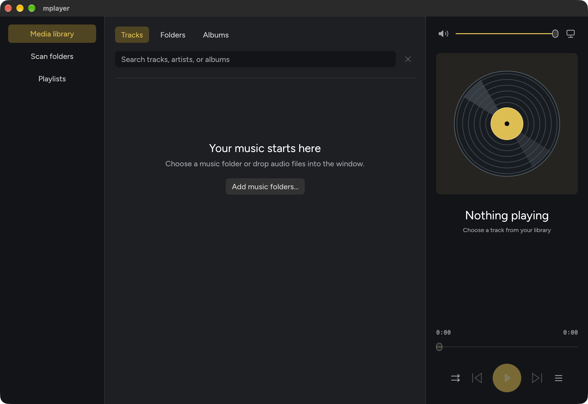

# mplayer

A desktop music player for local libraries. Browse tracks, folders, and albums;
build a play queue; and save playlists.



## Run

Build and launch with a current stable Rust toolchain and your platform's
[build requirements](docs/DEVELOPMENT.md#build-requirements):

```sh
cargo run --release --locked -p mplayer
```

To import music on launch, pass a folder or file:

```sh
cargo run --release --locked -p mplayer -- "/path/to/music"
```

## Using the player

- **Add music:** open **Scan folders** and click **+**, or drag files and folders
  into the window. Importing a single file also scans audio files in its folder.
- **Browse:** use the **Tracks**, **Folders**, and **Albums** tabs in **Media library**.
  Search for tracks, artists, albums, or folders. Open an album or folder to see
  its tracks.
- **Play:** double-click a track. Hover an album cover to play the whole album or
  append it to the current queue. Playing an album or playlist replaces the queue.
- **Manage the queue:** click **+** beside a library track to enqueue it. Open the
  queue with the three-line button beside the playback controls; use **−** to
  remove a track or the clear button to empty the queue.
- **Choose a play mode:** the button to the left of the playback controls cycles
  through sequential playback, repeat queue, and shuffle.
- **Save playlists:** open **Playlists**, enter a name, and click **+**. Add tracks
  through their right-click menu. Drag playlist tracks to reorder them and use
  **−** to remove entries or delete a playlist.
- **Choose an output:** use the device button beside the volume slider. The list
  shows available devices and their reported maximum PCM capabilities.
- **Update the library:** rescan after adding, moving, or removing music. The
  **Folders** tab shows scan status and error details. Removing a scan folder
  removes its tracks from the library and playlists while keeping files on disk.

Volume, output selection, library folders, and playlists are saved between runs.
The play queue lasts for the current session.

## Supported audio

Mono and stereo playback are supported.

| Format | Support |
| --- | --- |
| FLAC | Lossless PCM |
| WAV (`.wav`, `.wave`) | 8/16/24/32-bit integer PCM; 32/64-bit float; high sample rates |
| MP3 | MPEG audio |
| Ogg Vorbis | `.ogg`, `.oga` |
| DSD (`.dsf`, `.dff`) | DSD64, DSD128, DSD256; DST-compressed DFF |
| CUE sheets | Track boundaries and tags for audio files in the same folder |

PCM uses the source sample rate when the output device supports it and resamples
when needed. DSD is converted to PCM for playback. The player uses shared system
audio output; native DSD/DoP and exclusive output are unavailable.

WavPack, SACD ISO, DSD512, multichannel audio, and streaming URLs are not supported.
Embedded PNG/JPEG album covers are supported; external artwork files are not.

## Saved data

Release builds keep the library, playlists, settings, and `logs/` here:

| Platform | Location |
| --- | --- |
| macOS | `~/Library/Application Support/org.mplayer.mplayer/` |
| Windows | `%APPDATA%\mplayer\mplayer\data` |
| Linux | `$XDG_DATA_HOME/mplayer`, or `~/.local/share/mplayer` |

Debug builds use `target/debug/data/` when launched through Cargo.

## Development

See [development and diagnostics](docs/DEVELOPMENT.md) for platform setup,
tests, logging, and DSD comparison tools, or the
[DSD filter design](docs/FILTER.md) for the conversion mathematics.
